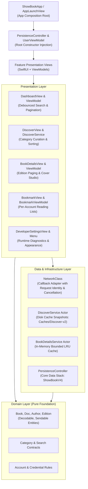
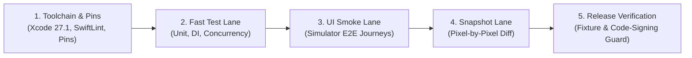
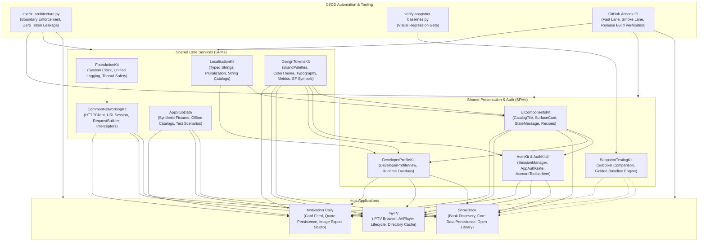

# ShowBook 📚

A modern, production-grade SwiftUI book discovery application exploring reactive search state, Core Data schema versioning, caller-owned network cancellation, and strict dependency injection.


Built by [Anurag Chourasia](https://github.com/Anurag-Chourasia), iOS Engineer. ShowBook interfaces with the public Open Library API to provide catalog browsing, multi-category exploration, paginated work/edition details, local multi-account management, per-account bookmarks, adaptive layouts, and native artwork sharing.

---

## 1. Executive Summary & Product Vision

ShowBook serves as a reference implementation for complex, real-world iOS client architecture. Rather than relying on untestable singletons or naive network calls, the application demonstrates:
- **Clean Persistence Boundaries (IOS-71)**: Full constructor injection of `PersistenceController` from the application composition root, completely eliminating shared singleton pollution and enabling isolated in-memory unit testing.
- **Request Identity & Caller-Owned Cancellation (IOS-70)**: Search and metadata requests carry discrete identities and caller-owned cancellation handles, guaranteeing that out-of-order or superseded network responses never corrupt the visible UI state.
- **Account-Owned Bookmarks & Migration (IOS-69, IOS-72)**: Versioned Core Data schema (`ShowBookV4`) with cryptographically salted PBKDF2-HMAC-SHA256 password hashing and isolated account bookmark partitions.
- **Showcase Developer Engine**: Includes dedicated `ShowBook Showcase` scheme booting credential-free directly into offline, curated fixture catalogs for zero-latency testing.

---

## 2. Architecture & Design Principles

ShowBook follows **Clean Architecture + MVVM** with strict layer decoupling and centralized root composition:



### Layer Breakdown:
1. **Presentation Layer (`ShowBook/View/`, `ShowBook/ViewModel/`)**:
   - Built entirely in SwiftUI with unidirectional data flow.
   - ViewModels encapsulate state, input validation, debounced queries, and error mapping.
   - Implements standardized accessibility identifiers across all actionable elements for reliable automated UI test execution.
2. **Domain Layer (`ShowBook/Model/`)**:
   - Pure Swift business models (`Book`, `Doc`, `Author`, `Subject`, `Edition`) independent of UI frameworks.
   - Decoupled from transport frameworks; JSON decoding maps directly to immutable value types.
3. **Data & Infrastructure Layer (`ShowBook/DataBase/`, `ShowBook/Discover/`, `ShowBook/BookDetails/`)**:
   - `PersistenceController`: Encapsulates Core Data setup, schema migration, and background context management.
   - `DiscoverService`: Actor-isolated service maintaining 24-hour disk cache snapshots under `Caches/Discover-v2`.
   - `BookDetailsService`: Actor-isolated service managing edition pagination and bounded LRU in-memory caching.
4. **Composition Root (`ShowBook/View/ShowBookApp.swift`)**:
   - Instantiates `PersistenceController` at the application entry point.
   - Replaces implicit `PersistenceController.shared` singletons with explicit constructor injection throughout the entire view hierarchy.

---

## 3. Shared SPM Package Integration

ShowBook integrates 8 shared Swift Packages to enforce architectural consistency and code reuse:

| Package | Integration Role | Host Ingestion Seam |
|---|---|---|
| **DesignTokensKit** (`v1.22.3`) | Brand palette (`BrandPalette.showBook`), spacing, typography, and SF Symbols. | `ShowBook/View/Book Item/`, `ShowBook/Discover/` |
| **UIComponentsKit** (`v1.9.0`) | Composable `CatalogTile`, `SurfaceCard`, `StateMessage`, and `TokenButtonStyle`. | `ShowBook/View/DashBoardView.swift`, `CatalogTile` |
| **AuthKit & AuthKitUI** (`v0.8.0`) | Authentication state machine, registration, and `AccountToolbarItem`. | `ShowBook/View/Content View/ContentView.swift` |
| **FoundationKit** (`v0.2.0`) | System clock abstractions (`AppClock`) and deterministic formatting. | `ShowBook/DataBase/Persistence/Persistence.swift` |
| **LocalisationKit** (`v0.8.1`) | Centralized string catalogs (`.xcstrings`) across en, fr, and ar. | Throughout all presentation views and ViewModels |
| **CommonNetworkingKit** (`v2.0.0`) | Core HTTP transport client and privacy-redacting HTTP logging. | `ShowBook/Model/NetworkClass.swift` |
| **DeveloperProfileKit** (`v1.2.0`) | "Know Your Developer" bio, credits, and verified outbound portfolio links. | Accessible via navigation drawer menu |
| **AppStubData** (`v1.0.0`) | Offline fixture catalogs (`showbook-developer-responses.json`) for Debug and Showcase. | `ShowBook/Developer/AppRuntime.swift` |
| **SnapshotTestingKit** (`v1.0.3`) | Tri-mode visual regression testing against pinned iOS simulator targets. | `ShowBookTests/BookCatalogRenderingTests.swift` |

---

## 4. Scripts, Tooling & Automation Catalog

All repository tooling is organized under `Scripts/`:

| Script | Purpose & Rationale | Local Execution Command |
|---|---|---|
| `bootstrap.sh` | Sets up submodules, checks private dependency access, and reproduces clean simulator build. | `bash Scripts/bootstrap.sh` |
| `check_design_tokens.py` | Scans codebase ensuring zero raw hex/RGB colors and full tokenization. | `python3 Scripts/check_design_tokens.py` |
| `check_release_developer_ui.py` | Asserts developer menus, debug fixtures, and test hooks are excluded from Release binaries. | `python3 Scripts/check_release_developer_ui.py` |
| `copy-developer-fixtures.sh` | Synchronizes static offline JSON catalogs from `AppStubData` into test bundles. | `bash Scripts/copy-developer-fixtures.sh` |
| `lint.sh` | Executes SwiftLint with strict compiler warnings-as-errors policy. | `bash Scripts/lint.sh` |
| `test-fast.sh` | Executes Fast test lane (unit tests, adapter verification, persistence logic). | `bash Scripts/test-fast.sh` |
| `test-smoke.sh` | Runs UI Smoke test lane for critical user journeys (Search -> Detail -> Bookmark). | `bash Scripts/test-smoke.sh` |
| `test-snapshots.sh` | Executes visual regression snapshot comparison on pinned iPhone 11 simulator. | `bash Scripts/test-snapshots.sh` |
| `test-integration.sh` | Runs integration tests verifying live/stub API endpoints and Core Data migrations. | `bash Scripts/test-integration.sh` |
| `verify-snapshot-baselines.py` | Validates reference PNG integrity and enforces anti-recording gate in CI. | `python3 Scripts/verify-snapshot-baselines.py` |
| `verify-snapshot-boundary.py` | Validates that snapshot test symbols and XCTest are never linked into Release builds. | `bash Scripts/verify-snapshot-boundary.py` |
| `verify_pins.py` | Asserts exact commit revisions for submodules match `dependencies.json`. | `python3 Scripts/verify_pins.py` |

---

## 5. Continuous Integration & Quality Gates

The GitHub Actions CI pipeline (`.github/workflows/ci.yml`) enforces multi-tiered verification on every PR and push to `main`:



### Quality Gate Requirements:
- **Strict Linting**: SwiftLint `0.65.1` with zero warnings tolerated.
- **Pinned Runtime Environment**: Apple iPhone 11 Simulator (iOS 18+), Xcode 27.1 toolchain.
- **Snapshot Anti-Recording**: Recording snapshots in CI (`RECORD_SNAPSHOTS=1`) immediately fails the pipeline.
- **Release Sanitization**: Release build inspection guarantees zero fixture payload leakages and strips developer settings.

---

## 6. Local Setup & Contribution Guide

### Prerequisites:
- macOS Sonoma or Sequoia with **Xcode 27.1** installed (`/Applications/Xcode 27.1.app`).
- Python 3.10+ installed and on `PATH`.
- Pinned iPhone 11 Simulator installed.

### Step-by-Step Setup:
```sh
# 1. Clone repository
git clone https://github.com/Anurag-Chourasia/ShowBook.git
cd ShowBook

# 2. Bootstrap dependencies and build Debug simulator binary
DEVELOPER_DIR='/Applications/Xcode 27.1.app/Contents/Developer' bash Scripts/bootstrap.sh

# 3. Run fast unit test suite
DEVELOPER_DIR='/Applications/Xcode 27.1.app/Contents/Developer' bash Scripts/test-fast.sh

# 4. Run UI Smoke tests
DEVELOPER_DIR='/Applications/Xcode 27.1.app/Contents/Developer' bash Scripts/test-smoke.sh
```

---

## 7. End-to-End Ecosystem Connectivity



---

## 8. Canonical Notion Dashboards & Governance Links

- [iOS Portfolio — Engineering Tickets Dashboard](https://app.notion.com/p/c20d7f4b133b44499c8ac0b4d5f6249e?pvs=204)
- [iOS Portfolio — Master Document](https://app.notion.com/p/40ffa5f855b98192ad2ede66a5d36fe7)
- [Architecture Boundary Validator (`check_architecture.py`)](file:///Users/anuragchourasia/Desktop/Projects/UIComponentsKit/Scripts/check_architecture.py)
- [Release & Gate Policy Documentation (`Docs/MASTER.md`)](file:///Users/anuragchourasia/Desktop/Projects/Docs/MASTER.md)
