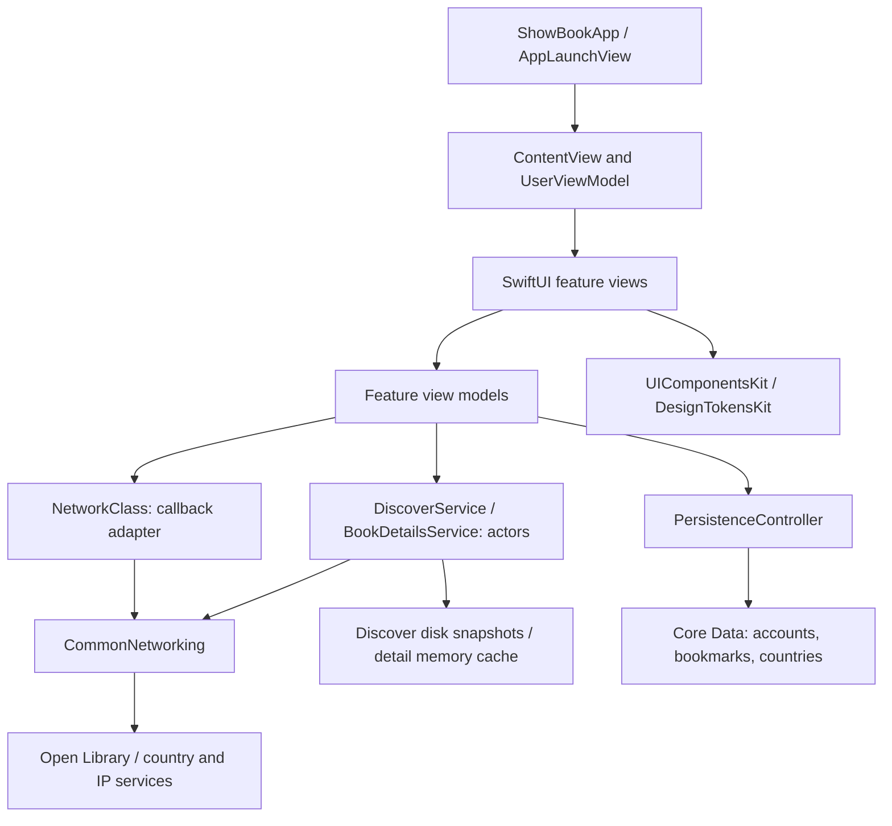

# ShowBook

**A SwiftUI book-discovery app exploring state correctness, local persistence, schema migration, and resilient API integration.**

Built by [Anurag Chourasia](https://github.com/Anurag-Chourasia), iOS Engineer. ShowBook combines Open Library discovery and search with work/edition details, local accounts, per-account bookmarks, adaptive catalog layouts, and native cover sharing.

This repository documents both the implementation and its boundaries. Features below are implemented unless explicitly listed under Future Plans.

## Engineering highlights

| Engineering decision | Why it matters | Implementation evidence |
|---|---|---|
| Reject stale search callbacks using request identity | An older response cannot replace results for the current query; failed pages do not advance the offset | [DashboardViewModel](ShowBook/ViewModel/DashBoardViewModel.swift), [regression tests](ShowBookTests/DashboardViewTests.swift) |
| Isolate asynchronous detail/cache state in actors | Keep request pacing and cache mutation coordinated across suspended operations | [BookDetailsService](ShowBook/BookDetails/BookDetailsService.swift), [DiscoverService](ShowBook/Discover/DiscoverService.swift) |
| Version the Core Data schema and migrate legacy credentials | Preserve existing accounts and bookmarks while evolving identity and credential storage | [PersistenceController](ShowBook/DataBase/Persistence/Persistence.swift), [migration tests](ShowBookTests/BookmarkViewModelTests.swift), [credential tests](ShowBookTests/LoginViewTests.swift) |
| Separate optional metadata from valid values | Missing ratings are not presented as genuine zero-star scores; old bookmarks without work keys remain usable | [Book model](ShowBook/Model/Models.swift), [book presentation](ShowBook/View/Book%20Item/BookItem.swift) |
| Keep developer behavior outside Release | Reproducible fixtures and configuration without making production behavior depend on stored debug preferences | [AppRuntime](ShowBook/Developer/AppRuntime.swift), [release binary guard](Scripts/check_release_developer_ui.py) |
| Share visual primitives and pin package revisions | Consistent catalog behavior across ShowBook and MyTV, with reviewable dependency upgrades | [dependency record](Scripts/dependencies.json), [design-token guard](Scripts/check_design_tokens.py) |

## User experience

1. **Enter the app.** Debug launches into Developer Settings; Release enters the normal account flow. Register or sign in with a local account.
2. **Discover or search.** Browse Fiction, Mystery, Science, or History, or search by title. Queries shorter than three trimmed characters show guidance instead of sending requests.
3. **Choose a presentation.** Switch list/grid layouts; sort by Title, Average, or Hits (rating count). Selected options have ticks and Clear is a separate destructive action. Accessibility text sizes resolve the catalog to a list.
4. **Explore a book.** Open work details, description, subjects, publication information, paginated editions, and individual edition metadata. Missing data and failed requests have explicit fallback/retry states.
5. **Save and return.** Bookmark books for the signed-in account. Saved artwork can be displayed offline when image data was stored.
6. **Share artwork.** Hold a cover to preview it, then open the native share sheet. Photos, Files, and compatible installed apps are offered by iOS. Cross icons dismiss preview/profile sheets.

The Hub hamburger menu groups Saved Books, Appearance, Know Your Developer, and Log out. Search and Discover put sorting and layout controls together. Loading, no results, short queries, and failures are distinct states; a failed subsequent page keeps existing results visible.

## Architecture

ShowBook uses **SwiftUI + MVVM with feature services and a Core Data persistence boundary**. It is an evolving codebase: legacy search/account networking uses callbacks, while newer Discover and details features use structured concurrency. Dependency injection exists at service/session and persistence seams; the app also retains shared instances. It is not a uniformly layered Clean Architecture implementation.



### Ownership and source map

| Area | Responsibility / starting point |
|---|---|
| App composition | [ShowBookApp](ShowBook/View/ShowBookApp.swift) provides the user model and managed-object context; [ContentView](ShowBook/View/Content%20View/ContentView.swift) selects authenticated navigation and supplies screen tools |
| Search | [DashboardViewModel](ShowBook/ViewModel/DashBoardViewModel.swift) owns query/result/page state; [NetworkClass](ShowBook/Model/NetworkClass.swift) preserves callback transport behavior |
| Discover | [DiscoverView](ShowBook/Discover/DiscoverView.swift) owns category/layout/sort choices; [DiscoverService](ShowBook/Discover/DiscoverService.swift) includes its view model and snapshot policy |
| Details | [BookDetailsViewModel](ShowBook/BookDetails/BookDetailsViewModel.swift) orchestrates work and edition loading through `BookDetailsServing` |
| Persistence | [PersistenceController](ShowBook/DataBase/Persistence/Persistence.swift) owns account transactions, credential migration, countries, and bookmark operations |
| Catalog and artwork | [BookItem](ShowBook/View/Book%20Item/BookItem.swift) composes shared tiles; [BookDetailsView](ShowBook/BookDetails/BookDetailsView.swift) also contains cover preview and sharing |
| Developer controls | [DeveloperSettingsView](ShowBook/Developer/DeveloperSettingsView.swift) owns Debug launch/shake presentation; [AppRuntime](ShowBook/Developer/AppRuntime.swift) selects flags, fixtures, and transport logging |

### Request lifecycle and failure behavior

- **Search:** a 500 ms input debounce feeds the dashboard. Each request has an identity; callbacks are applied on the main queue only when that identity still matches. Pagination advances after success. The callback adapter has no caller-owned cancellation handle: ignoring stale responses protects UI correctness but does not cancel the underlying request.
- **Discover:** category search requests explicitly include work keys, authors, covers, average ratings, and rating counts. Invalid work keys and duplicate keys are removed. A request identity prevents an old category response from replacing the latest selection.
- **Details:** validated work/edition keys determine endpoints. Requests reserve 0.4-second slots before suspension. Successful response data is held in memory for five minutes, with a 100-entry bound. Edition failures preserve the loaded work and retry offset.
- **Cancellation:** newer asynchronous services check cancellation around waits/network responses. Cancellation does not turn into a cached-success response in Discover.

### Storage and identity

| Data | Storage / contract |
|---|---|
| Accounts, countries, bookmarks | Core Data; current model is `ShowBookV4`, with historical models retained for migration |
| Credentials | Versioned PBKDF2-HMAC-SHA256 verifier with random salt; credential work is serialized off the main queue on background contexts |
| Bookmark identity | Work key plus account email where available; legacy records retain fallback matching and optional keys |
| Session and presentation preferences | UserDefaults / AppStorage; session identity is local, not a server-issued authentication token |
| Discover metadata | `Caches/Discover-v2`; category files separated by live/stub namespace; 24-hour freshness and existing-snapshot fallback on fetch failure |
| Artwork | Saved bookmark image data can survive offline; remote covers are not guaranteed to be cached with Discover metadata |

Credential migration clears logical plaintext fields after a successful transaction. Historical backups or SQLite pages are not claimed to be forensically erased. Local account separation is not a substitute for a server authentication/authorization system.

## Build and run

Run commands from this repository root.

- **Deployment target:** iOS 17.0; Swift 5 language mode.
- **Toolchain:** recent local validation used Xcode 27.1. The checked-in CI workflow explicitly pins Xcode 27.0; these are separate environments, not an interchangeable version guarantee.
- **Dependencies:** Swift Package Manager, including private repositories. Configure an authorized GitHub account with read access before resolving packages. CI uses repository-specific read-only deploy keys; `configure-private-dependencies.sh` is a CI helper, not a local credential installer.

```sh
xcodebuild -version
python3 Scripts/verify_pins.py
xcodebuild -resolvePackageDependencies -project ShowBook.xcodeproj -scheme ShowBook -onlyUsePackageVersionsFromResolvedFile -scmProvider system
xcodebuild -project ShowBook.xcodeproj -scheme ShowBook -configuration Debug -destination 'generic/platform=iOS Simulator' -derivedDataPath /tmp/ShowBookDerived CODE_SIGNING_ALLOWED=NO build
```

Open `ShowBook.xcodeproj`, choose the ShowBook scheme and a simulator, then run. Device deployment needs your signing team. Select the intended Xcode through `DEVELOPER_DIR` or your normal Xcode selection before running CLI commands.

### Shared packages

Exact versions and commit SHAs live in [Scripts/dependencies.json](Scripts/dependencies.json) and the Xcode package lockfile. CommonNetworking supplies transport; FoundationKit supplies utility behavior; DesignTokensKit and UIComponentsKit supply visual primitives; DeveloperProfileKit owns reusable profile content. LocalizationKit is linked but does not currently replace app-owned strings. Do not add artificial package usage solely to make a dependency appear integrated.

## Developer workflow

Debug starts with Developer Settings. Tap **Open ShowBook** to continue; shake to reopen settings over the current screen/sheet. Applying or dismissing the settings sheet rebuilds the app content to pick up configuration changes.

| Control | Scope |
|---|---|
| Live / Stub and success / empty / offline | Session-scoped fixtures for book, country, and IP endpoints; stub mode disables remote cover URLs but still uses local account/bookmark storage |
| Discover, cover preview, ratings | Debug feature flags; Release enables the normal features |
| HTTP logs | Redacted transport logging; stored toggle overrides the `HTTP_LOGGING=1` environment fallback; Release omits the logger |
| Discover A/B layout | Local list/grid override for visual testing, not remote experimentation or analytics |
| Version / build | Changes the profile display only, not bundle metadata or signing |
| Appearance | System, Light, or Dark, applied at the window so sheets/navigation inherit it |

## Verification and delivery

| Check | Command / evidence |
|---|---|
| Dependency integrity | `python3 Scripts/verify_pins.py` |
| Visual-token policy | `python3 Scripts/check_design_tokens.py` |
| Package tests | `python3 Scripts/test_dependencies.py` |
| Isolated networking/runtime tests | `python3 TestSupport/run-networking-tests.py` |
| App tests | `bash TestSupport/run-app-tests.sh /tmp/ShowBookDerived` — helper selects/boots an iPhone 18 Pro on iOS 27.0 |
| Release exclusion | Build Release, then run `python3 Scripts/check_release_developer_ui.py /tmp/ShowBookDerived/Build/Products/Release-iphonesimulator/ShowBook.app/ShowBook` |

[CI](.github/workflows/ci.yml) runs dependency checks, token checks, package/networking tests, Debug build, application tests, Release build, and developer-UI exclusion. It runs on main pushes, version tags, eligible pull requests, or manual dispatch; a feature-branch push alone is not a CI-pass claim.

Tests cover stale search responses, page retries, credential verification/migration, schema relationships, work/edition requests, Discover deduplication and offline fallback, and scene-hosted rendering. Some legacy tests download live artwork, so the whole suite is not fully offline. The ShowBook scheme retains a stale UI-test reference; the app-test helper explicitly selects the real `ShowBookTests` target. See [validation notes](TestSupport/README.md).

Manual checks remain necessary for VoiceOver, largest text sizes, shake presentation above another sheet, Photos/Files permissions and sharing extensions, and real-network behavior. No measured launch-time, coverage-percentage, or performance claims are implied by the presence of tests.

## Knowledge transfer

| Change or symptom | Start here | Contract to preserve |
|---|---|---|
| Wrong search results after rapid typing | Dashboard view model and dashboard regression tests | Request identity, main-queue publication, offset advancement only on success |
| New Open Library field or endpoint | Models, NetworkClass, BookDetailsService / DiscoverService | Optional metadata, URLComponents encoding, validated keys, live/stub separation |
| New persisted property | Versioned Core Data model and PersistenceController | Retain historical models; prove existing SQLite data migrates before shipping |
| Missing online details for an old bookmark | Persisted work key | Do not guess a work ID from a title; a fresh search may be required |
| New visual control | App views, then shared design tokens/components | Keep business state in the app; preserve accessibility list fallback and separate bookmark action |
| Cannot resolve packages | GitHub access, dependency record, CI credential setup | Do not change pins just to bypass missing repository access |
| Developer override appears ineffective | Build configuration and AppRuntime | Release intentionally ignores debug preferences; apply settings before retesting |

A useful handover demonstration is: reproduce a stale-search scenario, inspect the request guard, show a Discover cache fallback, trace an edition retry, then run the corresponding tests. Explain the invariant and evidence, not just the folder names.

## Current boundaries

- This is a local-account catalog app, not an e-book reader, cloud-sync service, or backend identity system.
- Shared singletons and the callback search adapter remain incremental-refactoring areas; dependency injection is not uniform.
- Persistence startup currently treats an unrecoverable store-load failure as fatal; a recovery UX remains future work.
- English UI literals remain; full localization and comprehensive accessibility automation are not complete.
- The app currently permits arbitrary loads through its ATS configuration. Review and narrow endpoint/transport requirements before a production release.

## Future Plans

Proposed enhancements, not completed features. Extend existing implementations where applicable.

| Enhance engineering skills | Enhance user experience |
|---|---|
| **Offline-first library:** local persistence, cache expiry, background refresh, and data migrations | Open saved books without internet and clearly identify outdated information. |
| **Reliable search pipeline:** strengthen cancellation, request deduplication, pagination, and stale-response protection | Faster search, recent searches, and fewer loading interruptions. |
| **Reading-progress model:** validated state transitions and persistent progress | Want to Read, Reading, Finished, and a Continue Reading section. |
| **Cross-device sync:** conflict resolution, retry handling, and deletion tracking | Keep reading lists and progress consistent across devices. |
| **Resilient image loading:** memory/disk caches, request coalescing, and cancellation | Faster covers, fewer blank images, and lower data usage. |
| **Accessibility validation:** automated checks plus VoiceOver and Dynamic Type testing | Comfortable browsing with large text and assistive technologies. |
| **Performance measurement:** launch benchmarks, scrolling analysis, and memory profiling | Smooth browsing as the saved library grows. |

First priority: the offline-first reading library. Preserve search, filters, layout,
and scroll position when returning from book details wherever that state currently resets.


## Author and data sources

[Anurag Chourasia](https://github.com/Anurag-Chourasia) · [LinkedIn](https://www.linkedin.com/in/anurag-chourasia-b66710178/)

Book metadata/covers come from Open Library; country/IP services support signup defaults. External availability and metadata completeness are outside the app's control. The application does not supply book text.
